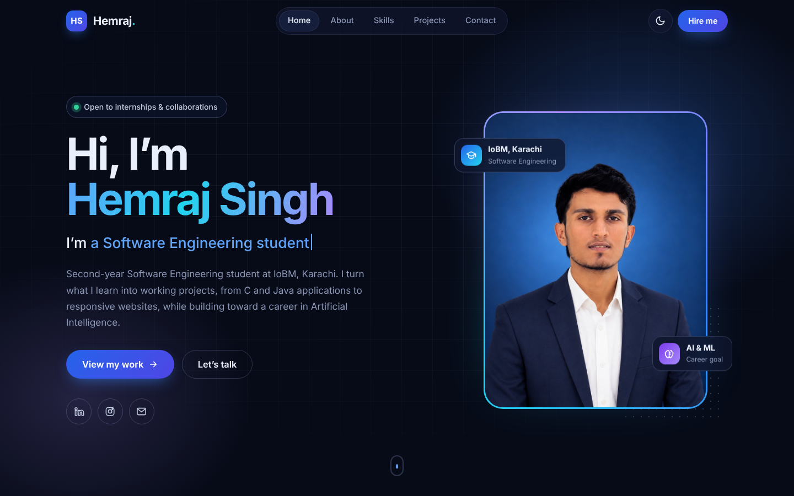

# Hemraj Singh — Portfolio

Personal portfolio website of **Hemraj Singh**, Software Engineering student at IoBM Karachi and
aspiring AI/ML Engineer. Built with plain **HTML, CSS and JavaScript**: no frameworks, no build step.



## Files

Everything lives in one folder:

| File | What it is |
| --- | --- |
| `index.html` | All page content (hero, about, skills, projects, contact) |
| `style.css` | All styles, with dark and light themes |
| `script.js` | All interactivity |
| `hemraj-singh.jpg` | Portrait photo (web-optimized, 80 KB) |
| `game.mp4` | Rock Paper Scissors demo video (web-optimized, 0.36 MB) |
| `game-poster.jpg` | Thumbnail shown before the video plays |
| `screenshot.png`, `screenshot-mobile.png` | Screenshots of the site |

## Run it

Double-click `index.html`, or open the folder in VS Code and use **Live Server**.

## Features

- Dark / light theme toggle, remembered on your device (follows the system theme the first time)
- Hero with your photo, animated gradient ring, typing role effect and social links
- About, Skills (animated progress bars), Projects and Contact sections
- Rock Paper Scissors demo video plays in a pop-up player
- Sticky header with active-section highlight, mobile slide-in menu, scroll progress bar, back-to-top button
- Contact form with validation and a hidden anti-spam field, ready to connect to a backend
- Responsive from 320px phones to large desktops; respects "reduce motion" settings; keyboard and screen-reader friendly

## Editing content

- **Text, skills, projects:** edit `index.html`. Each section is marked with a comment like `<!-- ===== Skills ===== -->`.
- **Skill level:** change `--level:90%` and the `aria-valuenow` and percentage text on that skill.
- **Typing words:** edit the `data-words` list on the `#typed` element in the hero.
- **GitHub links:** each project has a commented-out "Source code" button. Uncomment it and add your link.
- **Colors:** change the variables at the top of `style.css` (`[data-theme="dark"]` and `[data-theme="light"]`).

## Adding a backend later

The contact form is already prepared:

- Every field has a `name` (`name`, `email`, `subject`, `message`).
- `script.js` has a setting at the top:

  ```js
  const CONTACT_ENDPOINT = '';
  ```

  While it is empty, the form runs in **demo mode** (validates, but sends nothing).
  Set it to your API URL and the form will `POST` JSON like this:

  ```json
  { "name": "Ali", "email": "ali@example.com", "subject": "Internship", "message": "Hello…" }
  ```

  Any `2xx` response shows a success message; anything else shows an error.

### Example: Node.js + Express

1. In this folder run `npm init -y` and `npm install express`.
2. Create `server.js`:

   ```js
   const express = require('express');
   const app = express();

   app.use(express.json());
   app.use(express.static(__dirname)); // serves index.html, style.css, images…

   app.post('/api/contact', (req, res) => {
     const { name, email, subject, message } = req.body;
     if (!name || !email || !subject || !message) {
       return res.status(400).json({ ok: false, error: 'All fields are required.' });
     }
     // TODO: save to a database or send an email (e.g. with Nodemailer)
     console.log('New message:', { name, email, subject, message });
     res.json({ ok: true });
   });

   app.listen(3000, () => console.log('Portfolio running at http://localhost:3000'));
   ```

3. In `script.js` set `const CONTACT_ENDPOINT = '/api/contact';`
4. Run `node server.js` and open <http://localhost:3000>.

No-code option: create a free form at a service like Formspree and paste its URL into `CONTACT_ENDPOINT`.

## Deploy for free

- **Netlify Drop:** drag this folder onto <https://app.netlify.com/drop>.
- **GitHub Pages:** push the folder to a repository → *Settings → Pages → Deploy from branch*.
- With the Express backend: deploy to a Node host such as Render or Railway.

© 2026 Hemraj Singh
